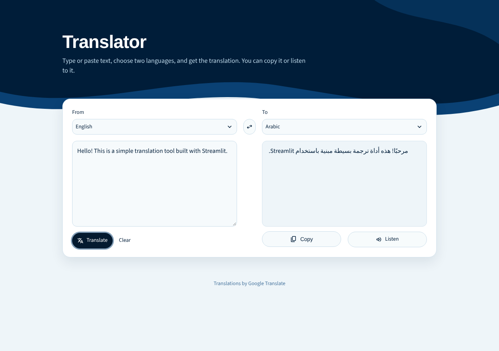

# Language Translator

A clean web app for translating text between 130+ languages, with one-click copy and text-to-speech.
Built for **Task 1** of the CodeAlpha Artificial Intelligence Internship.



## Features

- Enter text, then choose the source language (or **auto-detect**) and the target language.
- Translation through an API: Google Translate by default, or **Microsoft Translator** if you provide a key.
- If Google's free endpoint refuses the request (it sometimes rate-limits a whole network), the app retries through Google's public JSON endpoint, and as a last resort through the free **MyMemory** API. The footer shows which service produced the translation.
- The result is shown in a clear card. Right-to-left languages such as Arabic display correctly.
- **Copy** and **Listen** buttons (text-to-speech with gTTS).
- **Swap** button flips the languages and moves the translation into the input box.
- Input validation and friendly error messages: empty text, a 5,000-character limit, the same source and target language, and network failures.

## Tech stack

| Part | Tool |
|---|---|
| UI | Streamlit + custom CSS |
| Translation API | [`deep-translator`](https://github.com/nidhaloff/deep-translator) (Google Translate / Microsoft Translator) |
| Text-to-speech | [`gTTS`](https://github.com/pndurette/gTTS) |
| Tests | pytest + Streamlit `AppTest` |

## How it works

```
User text ──► validate() ──► Translation API ──► translated text ──► UI card
                                                       │
                                                       └──► gTTS ──► MP3 audio
```

All API logic lives in `translator.py`, separate from the UI in `app.py`. This keeps the logic testable without a browser.

## Project structure

```
├── app.py              # Streamlit interface
├── translator.py       # validation, translation API calls, text-to-speech
├── styles.py           # shared visual theme
├── .streamlit/config.toml
├── tests/              # unit + UI tests (API calls are mocked)
└── requirements.txt
```

## Run it locally

```bash
git clone https://github.com/MennatullahMourad/CodeAlpha_LanguageTranslator.git
cd CodeAlpha_LanguageTranslator
python -m venv .venv
# Windows: .venv\Scripts\activate    macOS/Linux: source .venv/bin/activate
pip install -r requirements.txt
python -m streamlit run app.py
```

The app opens at http://localhost:8501. It needs an internet connection, because translation and speech are done by online services.

### Optional: use Microsoft Translator instead of Google

1. Create a free *Translator* resource in the Azure portal.
2. Copy its key and region.
3. Set them as environment variables before running the app:

```bash
# Windows (PowerShell)
$env:MS_TRANSLATOR_KEY="your-key"; $env:MS_TRANSLATOR_REGION="your-region"
# macOS / Linux
export MS_TRANSLATOR_KEY="your-key" MS_TRANSLATOR_REGION="your-region"
```

The footer of the app shows which provider is active.

## Tests

```bash
pip install pytest
python -m pytest -q
```

The tests mock the translation API, so they run offline.

## Limitations

- The default Google provider uses the free public endpoint through `deep-translator`. Google can rate-limit it, sometimes for a whole network, so production apps should use an official API key.
- The MyMemory fallback has a daily free limit (about 5,000 characters without an account) and its translations can be less fluent than Google's.
- Microsoft uses slightly different codes for a few languages (e.g. Chinese and Hebrew). With the Microsoft provider, those languages may report "not supported".
- Text-to-speech covers the languages gTTS supports (~70). The Listen button is disabled for the rest.

## Author

**Mennatullah Mourad Elshoura** · CodeAlpha AI Internship
